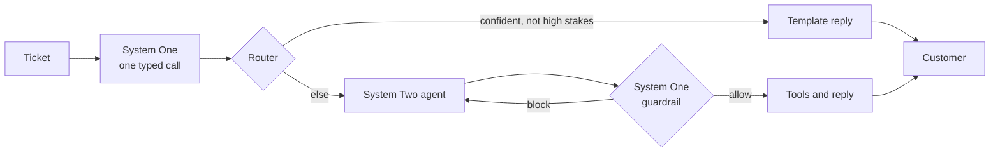
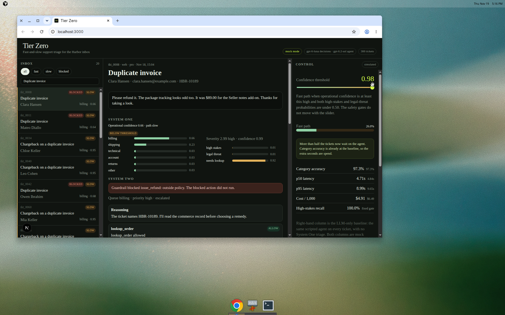
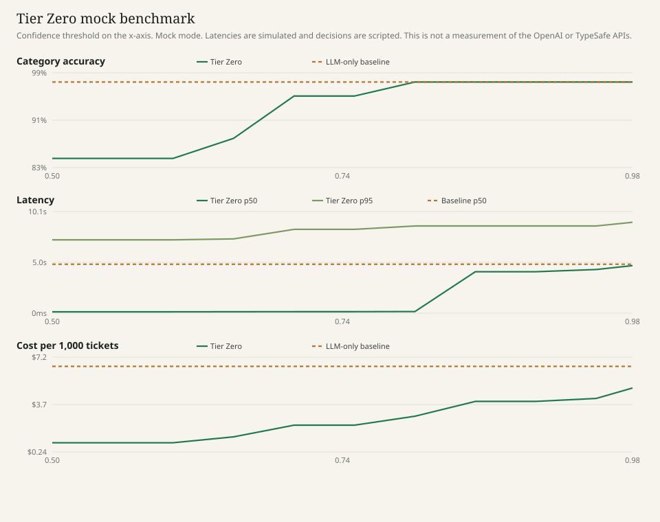

# Tier Zero

**Fast-and-slow AI support triage.**

Tier Zero pairs a System One model with a System Two agent on a support inbox. System One answers typed questions in one call: a category, a severity score, and a few calibrated yes/no probabilities. When it is confident and the ticket is not high stakes, the fast path tags the ticket and sends a pre-approved reply. Otherwise a tool-using agent writes the response, and System One checks every tool call and every draft before it runs.

This is a portfolio project by Jerry ([@awesomejerry](https://github.com/awesomejerry)). It is a support-triage demo. An unrelated AI-ops product is also named TierZero. This repository is not that product.

The inbox belongs to Harbor, a fictional commerce platform. Tickets are synthetic. The dashboard and the numbers below run with no API key.


## Why split the work

A frontier chat model can classify a ticket, but it is the wrong shape for the job. It writes when you wanted a probability, it is slow when the customer is one of thousands, and a confident wrong answer looks the same as a confident right one.

System One models give that up on purpose. OpenAI's Decisions API (`gpt-6-luna`, `POST /v1/decisions`) returns a probability, a choice, or a score, up to 400 questions in one request, at $0.10 per million uncached input tokens, with output tokens free. TypeSafe's Jev is the same idea from the other direction: early access, built to emit calibrated decisions and not strings. The agent is still there for the tickets that need a lookup, a refund, or a sentence a template should not invent.

The slider in the dashboard is the design. Drag it up and more tickets wait on the agent. Accuracy climbs toward the agent baseline, then stops, and after that you are paying latency for tickets the fast path already had right. High-stakes tickets never take the fast path, at any threshold.

## How a ticket moves



Triage asks five questions in that single call: queue, severity, high stakes, whether a lookup is needed, and whether the customer is threatening legal action. The router fast-paths only when operational confidence is at least the threshold and both stakes probabilities are under 0.50. Operational confidence is the weakest of the category confidence, the severity confidence, and how sure the yes/no answers are.

Details, request shapes, and the cost model are in [docs/architecture.md](docs/architecture.md).

## Quickstart

Node 22 and pnpm 10.

```bash
pnpm install
pnpm dev
```

Open [http://localhost:3000](http://localhost:3000). The inbox is mock mode. No key is read.

```bash
pnpm test          # router, guardrail, adapters, dataset bands
pnpm benchmark     # rewrites benchmarks/results.json and benchmarks/chart.svg
pnpm lint
pnpm typecheck
pnpm build
```

Copy `.env.example` to `.env` and set `OPENAI_API_KEY` before a live run. Live mode calls Decisions (`gpt-6-luna`) and Responses (`gpt-6.2-sol`):

```bash
pnpm benchmark --live
```

`--live` writes the same files. Do not commit a live run over the mock results without saying so in the file. `pnpm benchmark --check` fails CI if the committed mock outputs drift. Jev is wired as a provider and throws until the adapter in `packages/providers/src/jev.ts` is filled in.

## The dashboard

The left column is the inbox, colored by the path the current threshold chose. The center is the selected ticket: System One's distribution, and, on the slow path, the agent's reasoning, tool calls, and any guardrail block. The right column is the threshold, the live mix, and accuracy, latency, and cost against an LLM-only baseline that sends every ticket to the agent.

Dragging the slider does not call a model again. System One already ran. The router is a pure function, so the colors and the metrics move together.

At 0.80 on this seed the category accuracy matches the scripted baseline, the median ticket is still on the fast path, and 22 slow-path tickets show a blocked tool call or a blocked draft. Push the slider past that and p50 leaves the millisecond range while accuracy stays put.



Eval labels are hidden until you ask for them. They are how the metrics are scored. They are not shown to the reply.

## Benchmarks

These numbers are **mock / simulated**. Latencies come from a fixed distribution. Decisions come from the heuristic and the scripted agent, not from `gpt-6-luna` or `gpt-6.2-sol`. Do not cite them as API measurements. The dataset and the procedure are in [docs/dataset.md](docs/dataset.md).



| Threshold | Fast path | Category accuracy | p50 | p95 | Cost / 1,000 |
| --- | --- | --- | --- | --- | --- |
| 0.50 | 90% | 84.7% | 138ms | 7.25s | $0.91 |
| 0.70 | 73% | 95.0% | 152ms | 8.29s | $2.20 |
| 0.80 | 63% | 97.3% | 166ms | 8.62s | $2.85 |
| 0.85 | 43% | 97.3% | 4.10s | 8.62s | $3.93 |
| 0.98 | 26% | 97.3% | 4.71s | 8.99s | $4.91 |
| LLM-only baseline | 0% | 97.3% | 4.84s | 9.66s | $6.49 |

High-stakes recall is 1.00 at every row. The baseline is the scripted agent on all 300 tickets, priced at `gpt-6.2-sol` short-context rates, without the Decisions calls. Tier Zero's slow path adds those calls, which is why a fully escalated run costs more than the baseline even though most of the money is still the agent. Prices are in [docs/architecture.md](docs/architecture.md). Source file: [benchmarks/results.json](benchmarks/results.json).

## Design choices

**One Decisions call per ticket.** The five triage questions do not depend on each other. Batching them is both the latency win and the cost win. A question that needed an earlier answer would be a second call. We do not have one.

**The slider does not trade safety.** High stakes and legal threats are separate gates at 0.50. Operational confidence uses `max(p, 1-p)` for those predicates, so a coin-flip stakes answer escalates even though it is not over the gate.

**Templates instead of a small model on the fast path.** Approved copy cannot promise a refund it did not check. The cost is that easy tickets sound alike. That is the right cost for the demo.

**The guardrail is System One, not another agent.** It returns probabilities the code can threshold. `issue_refund` also refuses amounts over $50 if something calls it anyway.

**The mock agent misbehaves on purpose.** It proposes the full refund, including over the cap, and it drafts a guarantee when the customer demands one. The block is the thing the architecture is there to show. A live model is prompted not to do that. The traces will differ. The loop will not.

**Jev fails closed.** Early access, no credentials, no public request schema stable enough to pretend. The interface is there so the adapter is a file, not a rewrite.

**The baseline is slightly conservative.** Block-and-retry turns stay inside the agent trace the baseline is priced from. A real unguarded model might not take the retry. It also might send the bad reply. Category accuracy is what the table claims, not safety parity.

## What is not done

- A live benchmark. `pnpm benchmark --live` is wired. It has not been run here, and the committed chart must not be read as one.
- The Jev adapter. See the TODO in `packages/providers/src/jev.ts`.
- Prompt-cache hits. The cost model supports them. The mock always reports zero cached tokens.
- Production tools. Lookups, refunds, and escalation are in-memory records from the synthetic case file.

## Layout

```
packages/core        router, guardrail, agent loop, metrics
packages/providers   mock, OpenAI Decisions, OpenAI Responses, Jev stub
packages/dataset     seeded generator and cases.json
packages/benchmark   sweep and SVG chart
apps/web             Next.js dashboard
```

## License

MIT. Copyright 2026 Jerry.
