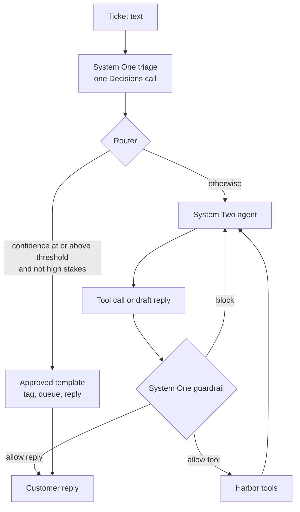

# Architecture

Tier Zero is a support-inbox pipeline with two models and a pure router between them.

System One answers typed questions. It does not write. System Two writes and calls tools. System One also sits in front of every tool call and every draft, because the thing that is cheap and calibrated is a better guardrail than a second writer.

This repository is a portfolio project. An unrelated AI-ops product is also called TierZero. Nothing here is that product.

## The path of one ticket

Triage questions are independent, so they travel in one request. The Decisions API allows 400 questions per call. Harbor asks five: category, severity, `is_high_stakes`, `needs_account_lookup`, and `has_legal_threat`.

Questions that depend on an earlier answer would be a second call. Harbor does not have any. The router reads the joint result.

## Providers

`SystemOneProvider` and `SystemTwoProvider` live in `@tier-zero/core`. Adapters live in `@tier-zero/providers`. The router never imports a network client.

| Provider | Role | Status |
| --- | --- | --- |
| `mock` | Heuristic System One and a scripted System Two | Default. Demo, tests, and the committed benchmark. |
| `openai-decisions` | `POST /v1/decisions`, model `gpt-6-luna` | Implemented. Used by `pnpm benchmark --live`. |
| `openai-responses` | `POST /v1/responses`, model `gpt-6.2-sol` | Implemented. Same live flag. |
| `jev` | TypeSafe Jev | Stub. Throws `JevNotAvailableError`. Early access only. |

The OpenAI Decisions request is `model`, `input`, and `questions`. `input` is a string or an ordered list of messages, function calls, and function outputs. Tool outputs carry `call_id`. A predicate answer is `{ type, name, probability }`. A choice answer adds `choice`, `probabilities`, and `confidence`. A score answer adds `score`, which is the probability-weighted index of the ordered levels. Any question can come back as `{ type: "refusal", name }` without failing the others. Output tokens on this endpoint are not billed.

The adapter validates that shape instead of casting the JSON. A refusal on a required triage question forces the slow path.

Jev is described publicly as the same kind of model: unstructured state in, typed probabilities out, output too cheap to meter, early-access pricing around $0.042 per million input tokens. The HTTP schema is not stable in the public post, and this project has no credentials, so the adapter fails closed. The TODO is in `packages/providers/src/jev.ts`.

## Router

Operational confidence is the minimum of:

- category `confidence`
- severity `confidence`
- `max(p, 1-p)` for `is_high_stakes`
- `max(p, 1-p)` for `has_legal_threat`

`needs_account_lookup` is shown in the UI and is not part of the gate. A template reply does not need the lookup. A probability near 0.5 on high stakes is uncertain, so `max(p, 1-p)` drops and the ticket escalates even though it is not yet over the stakes cutoff.

The fast path requires operational confidence greater than or equal to the slider, `is_high_stakes` below 0.50, and `has_legal_threat` below 0.50. The two cutoffs do not move with the slider. A legal ticket cannot be made cheap by dragging left.

The fast path sends a pre-approved template. It tags, chooses a queue, and sets a priority from the severity score. It does not promise a refund, a credit, or a guarantee. Those sentences are not generated, so there is nothing for a guardrail to catch. The cost of that choice is voice: every easy billing ticket sounds like the same careful note.

## Agent loop

System Two sees the ticket plus the tool list and returns reasoning, text, or tool calls. The loop is in core, not in the provider, so the mock and the Responses API share it.

Before a side effect runs, System One answers `within_policy` and `requires_human`. The call is blocked when policy probability is below 0.50, or when a refund scores 0.70 or higher on `requires_human`. The tool is not executed. The block text is appended as a function output and the agent has to adapt.

`propose_resolution` is the terminal tool. Its reply is checked for `promises_unsupported`, `discloses_internal`, and `admits_liability`. A blocked draft is not sent.

`issue_refund` also refuses amounts over 5000 cents inside the tool. The guardrail is supposed to stop the call first. The tool is the second lock, for a bypass or a bug in the threshold.

The mock agent is a script, not a language model. It will propose the customer's full refund, including amounts over the cap, and on tickets that demand a guarantee it will draft one. That is deliberate. The interesting object in the demo is the block, not a perfectly behaved writer. The live prompt tells `gpt-6.2-sol` to check policy first and not to do those things. Mock and live will not produce the same trace. The interface is the same.

## Cost and latency

Decisions, `gpt-6-luna`, from the Decisions guide and the standard prompt-cache rates:

- uncached input $0.10 / 1M
- cached input $0.01 / 1M
- 30-minute cache writes $0.125 / 1M
- output $0 on `/v1/decisions`

Cache reads and cache writes are subsets of `input_tokens`. The cost function subtracts both before applying the uncached rate.

System Two, `gpt-6.2-sol` short context:

- input $2 / 1M
- cached input $0.10 / 1M
- output $10 / 1M

Support tickets stay under the long-context threshold, so that multiplier is not applied.

Mock mode fills `usage` with `chars / 4` and fills `latencyMs` from a fixed distribution: most Decisions calls land between 80ms and 180ms, with a thin tail; an agent turn lands around 1.5s to 3s, with a tail. Nothing sleeps. `simulated: true` is on the result, on the metrics, and on the dashboard. A live run sets it to false and uses the token counts and the wall clock from the API.

The LLM-only baseline is the same agent trace without the triage call and without the guardrail calls. Recovery turns that exist because a guardrail blocked something are still inside the agent trace, so the baseline is slightly conservative: a bit more expensive than an agent that never saw a block. It is not a measurement of an unguarded `gpt-6.2-sol`.

## What the slider is measuring

System One runs once per ticket. The slider only re-evaluates the router. That is why it can move the whole inbox without another model call.

On the seeded set, in mock mode:

- Raising the threshold through the low-confidence band moves misclassified tickets onto the agent, and category accuracy climbs toward the baseline.
- Past that point the newly escalated tickets were already correct. Accuracy stays put. p50 latency jumps once more than half the inbox is slow, because the median ticket starts paying agent time.
- High-stakes recall does not move. Those tickets are slow at every threshold.

The committed chart is that curve. It is labeled mock. Re-run it with real keys before quoting it as anything else.

## Repository map

| Path | What it owns |
| --- | --- |
| `packages/core` | Types, questions, router, guardrail, tools, agent loop, metrics |
| `packages/providers` | Mock heuristic, OpenAI adapters, Jev stub |
| `packages/dataset` | Seeded generator and the committed 300 cases |
| `packages/benchmark` | Sweep, JSON results, SVG chart |
| `apps/web` | Next.js inbox |
| `benchmarks/` | Committed mock results. CI fails if they drift. |

## Failure behavior

- Missing `OPENAI_API_KEY` on `--live` exits before any call.
- HTTP errors surface the status and a short body. The key is not logged.
- More than 400 questions, or a duplicate name, is rejected locally.
- A Decisions refusal escalates.
- The agent loop stops after six turns and sends a specialist handoff if it never produced an allowed reply.
- Jev throws. A mis-set provider cannot silently answer as Jev.
